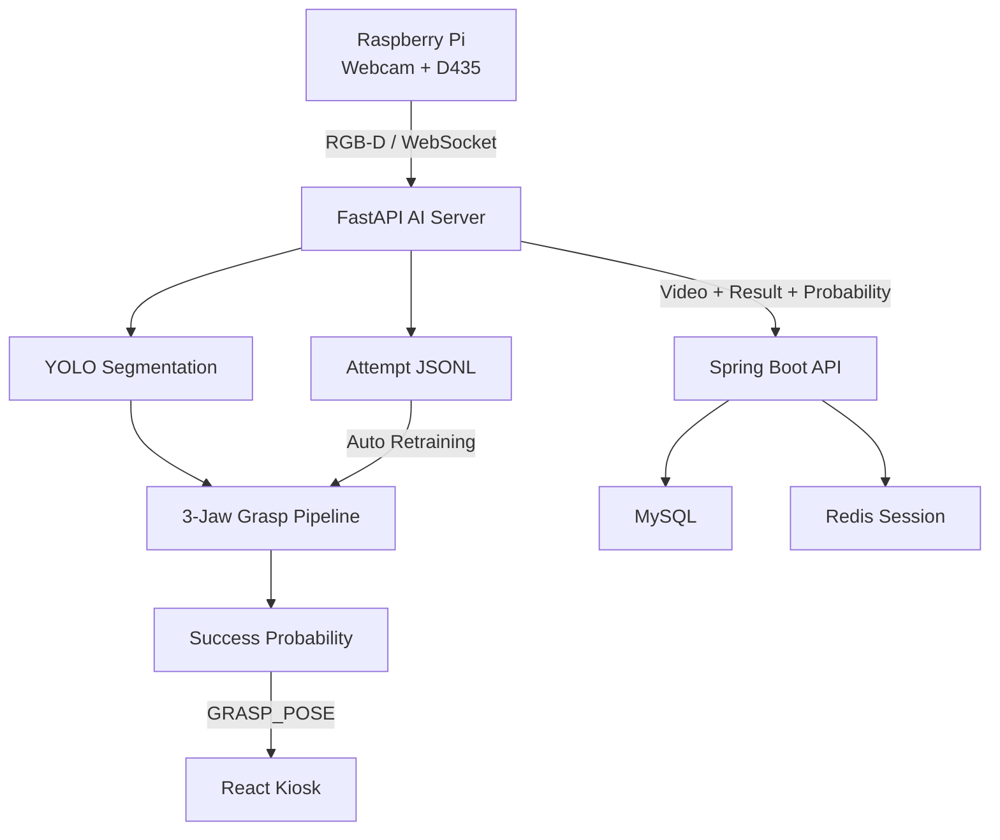

# JIPCHAK — 데이터로 진화하는 3발 인형뽑기

JIPCHAK은 웹에서 실제 인형뽑기 기계를 조작하고, 실시간 RGB-D 영상에서 인형과 파지 위치를 분석해 **현재 위치의 성공 확률**을 보여주는 피지컬 AI 프로젝트입니다.

기존 2발 집게용 Grasp 모델의 출력을 그대로 사용하는 데서 끝나지 않고, 3발 집게의 120° 접촉 구조와 인형 형상을 반영한 평가 파이프라인을 구성했습니다. 게임이 끝날 때마다 파지 조건과 실제 성공·실패 결과를 누적하며, 충분한 데이터가 모이면 성공 확률 모델을 자동으로 다시 학습합니다.

> SSAFY 14기 자율 프로젝트 D108팀

## 핵심 기능

- Raspberry Pi에서 웹캠 RGB, RealSense D435 RGB·Depth 영상을 동시 수집
- WebSocket과 MessagePack으로 카메라 영상을 AI 서버 및 브라우저에 실시간 전송
- YOLO Segmentation으로 인형 마스크를 검출하고 3발 집게 파지 후보 생성
- 집게 간 120° 간격, 목 포착, 하부 지지, 주변 여유 공간을 반영한 초기 점수 계산
- 게임별 파지 특징과 성공·실패 결과를 JSONL로 자동 누적
- 최소 데이터·클래스 균형 조건 충족 시 MLP 자동 재학습 및 무중단 모델 교체
- 데이터량에 따른 sigmoid/isotonic 확률 보정 및 hold-out 기반 모델 평가
- 예측 확률, 실제 결과, 플레이 영상을 Spring Boot·MySQL에 함께 저장
- QR을 이용한 플레이 영상 모바일 조회 및 다운로드

## 시스템 구성



| 영역 | 역할 |
|---|---|
| `embedded/` | 카메라·Depth 수집, Arduino 입력 처리, AI 서버 송신 |
| `ai/` | 영상 릴레이·녹화, 인형 분할, 3발 파지 평가, 성공 판정, 자동 학습 |
| `backend/` | 게임 결과·예측 확률·영상 메타데이터 저장, Redis 세션 관리 |
| `frontend/` | 키오스크 플레이 화면, 실시간 확률 게이지, QR·관리 화면 |
| `infra/` | MySQL, Redis, Spring Boot, React, Nginx, Jenkins 구성 |
| `exec/` | 포팅 매뉴얼, 시연 자료, DB 스크립트 |

## 성공 확률 자동 학습

### 1. 한 게임에서 저장하는 입력

파지 직전 가장 최근의 유효한 추론 결과 한 건을 실제 게임 결과와 연결합니다.

| 특징 | 의미 |
|---|---|
| `width` | 파지 후보의 집게 폭 |
| `original_score` | YOLO 검출 신뢰도 |
| `center_z` | 파지 중심 깊이 |
| `sin(angle)`, `cos(angle)` | 집게 회전 방향 |
| `depth_median` | 중심 주변 Depth 중앙값 |
| `depth_roughness` | 표면 굴곡 정도 |
| `sensor_invalid_ratio` | 유효하지 않은 Depth 비율 |
| `aspect_ratio` | 인형 마스크 종횡비 |
| `width_variance` | 목처럼 폭이 변하는 형상 정도 |
| `relative_grasp_y` | 인형 내부에서 파지점의 상하 위치 |
| `gripper_distance_ratio` | 집게-인형 중심 거리 ÷ 파지 폭 |
| `top_bias` | 인형 상단 파지 적합도 |
| `neck_capture` | 3발 집게의 목 포착 정도 |
| `support` | 파지점 아래의 지지 영역 비율 |
| `clearance` | 집게 끝 주변의 Depth 여유 |

사람이 지정한 `width`, `neck_capture`, `support` 가중치를 매 게임마다 수정하는 구조가 아닙니다. 초기에는 규칙 점수를 사용하지만, 이후에는 누적된 **특징 벡터 + 실제 성공/실패 라벨**로 MLP가 조건과 성공의 관계를 학습합니다.

### 2. 자동 재학습 조건

기본 설정은 다음과 같습니다.

- 전체 유효 데이터 30건 이상
- 성공 5건 이상, 실패 5건 이상
- 최초 학습 이후 새로운 데이터 10건 누적
- train/validation 계층 분할, feature 표준화, early stopping 적용
- 모델 선택용 validation과 확률 보정용 데이터를 분리
- 보정 표본이 부족하면 보정 생략, 충분하면 sigmoid 또는 isotonic 적용

조건이 충족되면 별도 스레드에서 후보 모델을 학습합니다. 새로 수집할 때부터 별도로 예약한
hold-out은 학습·모델 선택·확률 보정에 사용하지 않습니다. 같은 hold-out에서 기존 모델과
후보 모델을 비교하고, Brier Score 개선·Log Loss 및 인형별 성능 악화 제한·표본 및 불확실성
기준을 모두 통과한 후보만 반영합니다. 최초 모델은 해당 평가 기록에 함께 저장한 규칙 기반
예측값을 기준으로 비교합니다.

`GRAB_START` 이벤트에서 파지 직전의 최근 관측을 확정하며, 판정 불가·오래된 관측·파지 이후
추론은 학습에서 제외합니다. 모델은 운영 파일 변경 전에 별도로 검증하고, 이전 버전을
보관해 교체 실패와 손상 파일의 재시작 상황에 대응합니다. 승격/거절 근거는 JSONL로 남깁니다.
세부 설정과 롤백 방법은 [`ai/MODEL_PROMOTION.md`](ai/MODEL_PROMOTION.md)를 참고하세요.

### 3. 데이터 흐름

```text
파지 후보 + RGB-D 특징
        ↓
현재 성공 확률 예측
        ↓
게임 종료 후 Depth 변화로 성공/실패 판정
        ↓
features + success(0/1) JSONL 누적
        ↓
데이터 조건 충족 시 자동 재학습
        ↓
동일 hold-out 평가 기준 통과 시 새 모델 적용 (미달 시 기존 유지)
```

초기 데이터가 부족하면 `prediction_source=rule`, 학습 모델이 활성화되면 `prediction_source=ml`로 WebSocket 응답에 표시됩니다. `/health`에서도 학습 데이터 수와 현재 예측 방식을 확인할 수 있습니다.

## 기술 스택

| 구분 | 기술 |
|---|---|
| Frontend | React 19, TypeScript 5.9, Vite 8, Zustand, Tailwind CSS, Recharts |
| Backend | Java 21, Spring Boot 3.5, Spring Data JPA, WebSocket |
| AI/ML | Python, FastAPI, PyTorch 2.4, Ultralytics YOLO, OpenCV, NumPy |
| Embedded | Raspberry Pi, Intel RealSense D435, Arduino Uno, Python, C++ |
| Data | MySQL 8.0, Redis |
| Infra | Docker Compose, Nginx, Jenkins, AWS EC2, RunPod GPU |
| Protocol | WebSocket, MessagePack, LZ4, REST multipart/form-data |

## 주요 API와 WebSocket 이벤트

### AI Server

| 경로 | 방향 | 설명 |
|---|---|---|
| `GET /health` | Client → AI | 모델 로드·학습 데이터·구독자 상태 확인 |
| `WS /ws/camera` | RPi → AI | 제어 이벤트 및 RGB-D 프레임 송신 |
| `WS /ws/stream` | AI → Browser | 영상 프레임과 추론·게임 이벤트 송신 |

`GRASP_POSE` 예시:

```json
{
  "event": "GRASP_POSE",
  "center_x": 311.4,
  "center_y": 207.8,
  "angle_rad": 0.31,
  "radius": 75.0,
  "jaw_count": 3,
  "confidence": 0.73,
  "prediction_source": "ml",
  "image_width": 640,
  "image_height": 480
}
```

### Backend

`POST /api/game/log`은 `multipart/form-data`를 사용합니다.

| 필드 | 타입 | 필수 | 설명 |
|---|---|---:|---|
| `sessionId` | String | 아니요 | 게임 세션 식별자 |
| `isSuccess` | Boolean | 예 | 실제 성공 여부 |
| `successProbability` | Double | 아니요 | 파지 직전 예측 확률, 0.0~1.0 |
| `video` | MP4 | 예 | 플레이 녹화 영상 |

응답에는 `id`, `sessionId`, `isSuccess`, `successProbability`, `qrCodeKey`, `videoUrl`, `createdAt`이 포함됩니다.

## 로컬 실행

### 사전 요구사항

- Java 21
- Node.js 24 이상
- Python 3.11 이상
- MySQL 8.0, Redis 또는 Docker Compose
- AI 전체 추론 시 YOLO 체크포인트와 CUDA 사용 가능 GPU 권장

### AI 서버

```bash
cd ai
python -m venv .venv
source .venv/bin/activate              # Windows: .venv\Scripts\activate
pip install -r requirements.txt

export SPRING_API_BASE_URL=http://localhost:8080
export RECORDING_DIR=./data/recordings
export SUCCESS_LEARNING_DATA_PATH=./data/learning/grasp_attempts.jsonl
export SUCCESS_MODEL_PATH=./data/learning/success_evaluator.pth

python -m uvicorn main:app --host 0.0.0.0 --port 8000
```

```bash
curl http://localhost:8000/health
```

### Backend

```bash
cd backend

export DB_HOST=localhost
export DB_USERNAME=root
export DB_PASSWORD=your_password
export REDIS_HOST=localhost

./gradlew bootRun
```

### Frontend

```bash
cd frontend
npm ci
echo "VITE_WS_STREAM_PATH=ws://localhost:8000/ws/stream" > .env.local
npm run dev
```

### 인프라 통합 실행

```bash
cd infra
cp .env.example .env
# DB_PASSWORD, HOST_VIDEO_DIR, VITE_WS_STREAM_PATH 등 수정
docker compose up -d --build
```

AI 서버는 GPU 운영 환경에서 RunPod로 분리하는 구성이 기본입니다. 자동 학습 데이터와 모델이 재시작 후에도 유지되도록 `/data/learning`을 영속 볼륨에 연결해야 합니다.

## 자동 학습 환경변수

| 변수 | 기본값 | 설명 |
|---|---|---|
| `SUCCESS_LEARNING_ENABLED` | `true` | 게임 결과 자동 학습 활성화 |
| `SUCCESS_LEARNING_DATA_PATH` | `/data/learning/grasp_attempts.jsonl` | 누적 학습 데이터 |
| `SUCCESS_MODEL_PATH` | `/data/learning/success_evaluator.pth` | 현재 성공 확률 모델 |
| `SUCCESS_LEARNING_MIN_SAMPLES` | `30` | 최초 학습 최소 데이터 수 |
| `SUCCESS_LEARNING_MIN_CLASS_SAMPLES` | `5` | 성공·실패 각각의 최소 데이터 수 |
| `SUCCESS_LEARNING_RETRAIN_EVERY` | `10` | 재학습에 필요한 신규 데이터 수 |
| `SUCCESS_LEARNING_EPOCHS` | `120` | 최대 epoch 수 |
| `SUCCESS_LEARNING_BATCH_SIZE` | `32` | 학습 batch size |

전체 AI 환경변수는 [`ai/README.md`](ai/README.md), 배포 절차는 [`exec/포팅매뉴얼.md`](exec/포팅매뉴얼.md)에서 확인할 수 있습니다.

## 테스트

```bash
# AI
cd ai
python -m pytest tests -q

# Backend
cd backend
./gradlew test

# Frontend
cd frontend
npm run check
```

자동 학습 테스트는 데이터 품질·파지 시점 확정·동일 hold-out 비교·후보 거절·동시 학습 방지·
학습 및 교체 실패·재시작 복구·평가 데이터 누출 방지를 검증합니다.

## 프로젝트 구조

```text
jipchak/
├── ai/
│   ├── src/inference/              # YOLO·Grasp·성공 판정
│   ├── src/learning/               # 게임 결과 누적·자동 재학습
│   ├── src/network/                # RPi/Browser WebSocket, Spring client
│   ├── three_jaw_grasp/            # 공통 후보·평가기·feature·trainer
│   └── tests/
├── backend/src/main/java/com/jipchak/server/
│   ├── controller/
│   ├── service/
│   ├── repository/
│   └── entity/
├── frontend/src/
│   ├── components/
│   ├── pages/
│   └── store/
├── embedded/raspberrypi/
├── infra/
└── exec/
```

## 운영 시 확인할 점

- 성공 확률 모델의 품질은 실제 성공/실패 라벨의 정확도에 직접 영향을 받습니다. Depth 기반 성공 판정 임계값을 설치 환경에서 먼저 검증해야 합니다.
- 최초 30건 이전의 값은 학습된 확률이 아니라 규칙 기반 초기 점수입니다.
- 성공 또는 실패 한쪽만 누적되면 재학습하지 않습니다.
- `SUCCESS_LEARNING_DATA_PATH`와 `SUCCESS_MODEL_PATH`는 같은 장비의 영속 저장소에 두는 것을 권장합니다.
- 기존 11차원 실험 모델은 현재 16차원 입력과 호환되지 않으며, 런타임이 이를 감지하면 규칙 기반 모드로 안전하게 전환합니다.
